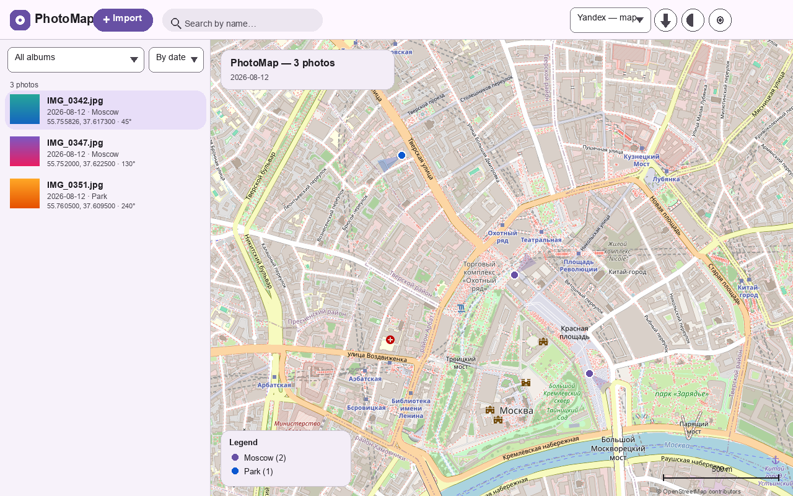
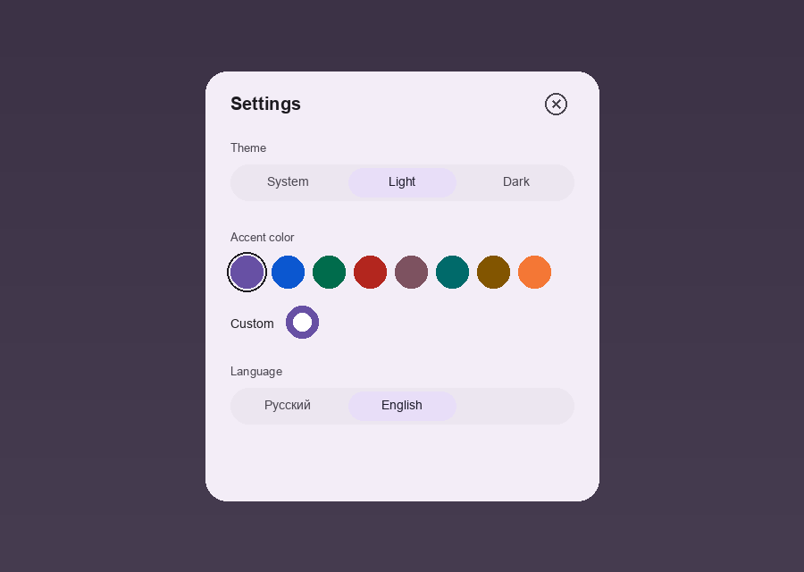

# PhotoMap

A small desktop app that puts your photos on a map. It reads GPS coordinates and the shooting direction (the compass azimuth) straight from EXIF, so every photo gets a marker that also shows which way the camera was pointed.

Built with [Tauri 2](https://v2.tauri.app/).

[Русская версия →](README.ru.md)

## What it does

- **Import folders** — drag them in or pick them with a dialog. Files without GPS are skipped.
- **Base maps** — OpenStreetMap, Yandex (map / satellite) and Google (map / satellite / hybrid).
- **Direction cones** — when a photo carries `GPSImgDirection`, its marker shows the field of view as a translucent wedge. Photos without a heading just get a dot.
- **Two-way selection** — click a marker and the sidebar scrolls to that photo; click a photo in the sidebar and the map pans to it.
- **Clustering** for large albums, plus search, album filter and sort by date/name.
- **Photo viewer** — double-click a photo for a full-screen view with the EXIF details.
- **Export** — KML, GeoJSON, and a PNG snapshot of the current view (with a legend listing albums).
- **Material You** look with an accent-color picker and light/dark/system theme.
- **English and Russian** interface.
- **Auto-update** — checks for new versions on startup and installs them after you confirm.
- **Labels & copy** — show photo names on the map and in exports; right-click a photo to copy its coordinates or a Google Maps link; copy the snapshot straight to the clipboard.

## Screenshots

| Map with direction cones | Settings |
| --- | --- |
|  |  |

## Download

Grab an installer from the [Releases](../../releases) page. Windows gets an `.msi` / `.exe`, macOS a `.dmg` (Intel and Apple Silicon), Linux a `.deb` and an AppImage.

> macOS: the app isn't notarized, so Gatekeeper may complain. If you see a
> "damaged app" message, clear the quarantine flag:
> `xattr -d com.apple.quarantine /Applications/PhotoMap.app`

## Running from source

You need Node.js 20+ and a recent Rust toolchain.

```bash
npm install
npm run tauri dev
```

On Linux you'll also need the usual Tauri system libraries (`libwebkit2gtk-4.1-dev`, `libgtk-3-dev`, `libayatana-appindicator3-dev`, `librsvg2-dev`).

## Making a release

Releases are built automatically by GitHub Actions. Bump `version` in `src-tauri/tauri.conf.json`, then:

```bash
git tag v0.1.0
git push origin v0.1.0
```

The workflow builds installers for Windows, macOS (Intel + Apple Silicon) and Linux and publishes them to the Releases page automatically.

## Notes

- Coordinates come from the standard EXIF GPS tags; direction comes from `GPSImgDirection` / `GPSImgDirectionRef` (magnetic values are used as-is).
- HEIC/HEIF previews work on macOS. On Windows and Linux the backend can't decode them, so you'll see a placeholder thumbnail — the coordinates still import fine.
- Google and Yandex tiles are used as-is with attribution. If you ship this somewhere commercial, check their terms first.

## License

MIT — see [LICENSE](LICENSE).
